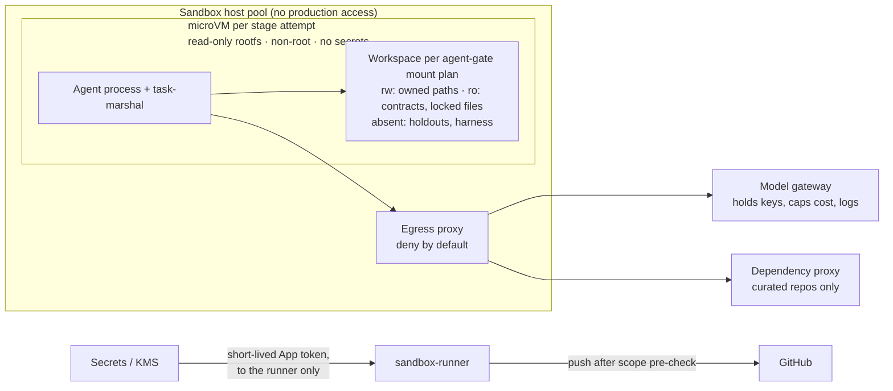

# Isolation and security

## Threat assumptions

- Any text an agent reads may contain a prompt injection: issues, comments, repository files,
  dependency READMEs, wiki pages.
- Some injections will succeed. The design makes success useless, rather than relying on
  detection.
- No agent may combine all three of: untrusted input, access to sensitive data, and a way to
  communicate externally.

## Runtime isolation

**Controls:**

- **One microVM per stage attempt,** destroyed afterwards. No write-shared caches between
  stages. gate-warden runs its checks in microVMs of its own, from a clean checkout.
- **Hardware-virtualised isolation.** Containers alone are not enough (ADR-0005).
  - **Reference provider:** microsandbox, which uses libkrun microVMs.
  - **Alternatives** behind the same CogWorks runtime-provider interface: Firecracker and Kata
    Containers.
  - **gVisor:** a fallback for T0/T1 only.
- **KVM is required.** On-prem that means bare metal; in the cloud, metal instances or instances
  with nested virtualisation enabled.
- **No secrets inside the sandbox.** The model gateway injects model API keys. The runner holds
  the role's short-lived GitHub App token and pushes on the agent's behalf.
- **Deny-by-default egress.** Only the model gateway and the dependency proxy are reachable.
  - Profiles that need web research get a separate network profile **with no write access and
    no source access**.
  - lore-keeper is reachable only from profiles whose contract allows it, read-only.
- **Dependencies only through curated repositories.** A new direct dependency is a human
  decision (H4).
- **Budgets enforced outside the agent:** turns, tokens, wall-clock time and cost.

## Identity

- **One GitHub App per role:** designer, oracle, builder, reviewer, health, gate-warden,
  release-ratifier, plus the existing service Apps.
- **Permissions:** each App gets the minimum repository permissions for its role.
- **Tokens:** issued per run by the KMS, and valid for minutes.
- **Required checks:** restricted to the gate-warden App as source, so no agent can forge a
  green check.

## Enforcement layers for path ownership

Path ownership is enforced at several layers, most authoritative first:

1. **gate-warden scope check** (agent-gate CLI) across the whole commit range. Authoritative.
2. **Oracle integrity and config guard** (signed manifest).
3. **Required checks restricted to the gate-warden App.**
4. **Push rulesets restricting file paths,** where the GitHub plan supports them.
5. **Sandbox mount plan:** paths absent, read-only, or owned by a different user with sticky
   directories.
6. **In-sandbox feedback:** commit-gate wrapper, agent-gate hooks.

Layers 5–6 give fast feedback and depth. Agent-side hooks run inside the agent process and are
never the primary control.

## Prompt-injection rules

- **Never interpolate untrusted event fields into prompts** or workflow expressions
  (`${{ github.event.issue.title }}` and the like).
- **No agent work is started by external actors.** queue-keeper tags actor trust, and consumers
  refuse untrusted events. `pull_request_target` is forbidden for agent jobs.
- **Raw untrusted text is summarised only in quarantine** (Entry Sentinel's LLM pass: no tools,
  fixed schema). Privileged profiles see structured, attested inputs and human-approved specs.
- **Repository content is data.** Reviewers are injection targets too: they cannot write, and
  their findings can only add work, never approve it.
- **Every run starts from harness files the agent cannot write.** In-repo `CLAUDE.md` and
  `AGENTS.md` files are human-owned and path-protected.

## Provenance

Every stage attempt emits an in-toto attestation, signed through chain-chronicler's library with
a key held in the KMS. Its predicate contains:

- stage type, profile and version, identity role
- model ID and version, harness version, persona/prompt hash
- input-bundle digest, output digest
- gate results
- approving human (if any)

The attestations chain from requirement ID to approved criteria, oracle, code, gate results and
release approval. release-ratifier checks that the chain is complete before release, and
attaches it to the GitHub Release. Build provenance follows SLSA.
