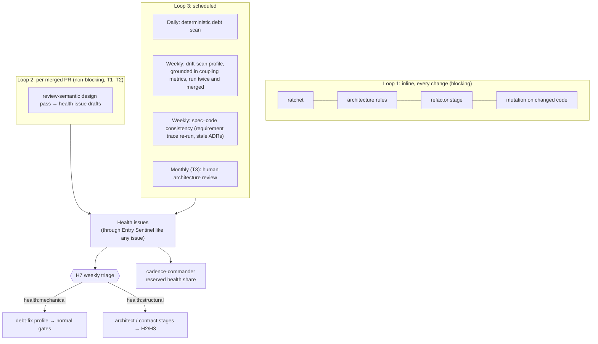
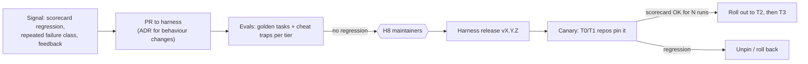

# Operating the factory

This page covers what keeps the system healthy over time: code-health loops, observability, and
changing the harness safely.

## Code-health loops

**Policies:**

- **Protected capacity.** cadence-commander reserves a share of the issue ordering (start at 20%)
  for confirmed health issues.
- **Ratchets, not absolutes.** Baselines may only stay flat or improve. Any regression is an
  explicit exception, which gate-warden records and review-reeve lists first in the evidence
  report.
- **Evidence or drop.** Drift findings must cite a metric, files and a rule. Findings without
  evidence are discarded automatically.
- **Narrow dark scope.** Only mechanical classes go dark: unused dependencies, duplication
  extraction, lint debt, dead code. Anything that moves a boundary goes back through design.
- **Early-warning metric:** files changed per small change. A rising median is the earliest
  sign of eroding modularity.

Scheduled scans are CogWorks runs triggered on a schedule. Their output is GitHub issues, so the
rest of the pipeline treats them like any other work.

## Observability

chain-chronicler owns the telemetry pipeline, and webhook-watchman covers the event path.

- **One trace per issue,** with spans per stage, attempt, agent turn, tool call and gate check.
  The trace is linked from the check-run summary.
- **Live view:** what is running, what is waiting on whom, cost against budget, and the last
  failing gate.
- **Kill switches:** per run, per profile, per harness version, and global. A kill switch is
  itself GitHub-visible state, such as a label or a pinned config, so it survives restarts.

**Minimum event schema:**

- run and work identifiers: `run_id`, `issue`, `slice`, `stage_type`, `attempt`, `discipline`
- who ran it: `profile`, `profile_version`, `identity_role`, `model`, `model_version`,
  `harness_version`, `prompt_hash`
- what went in and out: `input_digest`, `output_digest`, `gate_results[]`
- cost: `tokens_in`, `tokens_out`, `cost`, `duration`
- human decisions: `human_decision`, `decided_by`

**Factory scorecard:**

| Category | Metrics |
| --- | --- |
| Flow | Lead time issue → merge → release; time waiting on humans; attempts per slice |
| Gate health | Pass rate per gate, failure classes, escalation rate, disputes and outcomes |
| Honesty | Visible-vs-holdout gap; sniff hits; cheat-trap results; blocked tamper attempts |
| Quality outcomes | Escaped defects traced to changes; change failure rate; reverts |
| Human gates | Rate of approvals that change nothing, time-to-decision, reasons for changes |
| Health | Metrics from the code-health loops |
| Cost | Tokens and money per merged slice, per tier; sandbox compute; rework cost |
| Attribution | All of the above, sliced by model, harness version, profile and prompt hash |

## Changing the harness safely

The harness is a product with its own release process.

- **Golden tasks:** representative issues per tier with known-good outcomes. They are re-run on
  every harness change and every model-version change.
- **Cheat traps:** seeded tasks where the visible tests contradict the spec. The correct outcome
  is a dispute. Any "pass" blocks the harness release.
- **Pins:** each repository pins a harness version in `.factory/pin.yaml`. Model versions are
  pinned in the gateway config and go through the same evals.
- **Learning loop:** a recurring gate-failure class leads to a proposed new check, rule or
  skill, which a human approves.
- **Discipline packs** follow the same process, with their own golden tasks and cheat traps.
