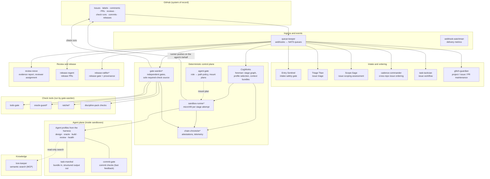

# System architecture

This page describes the whole system: its layers, the components in each layer, and how events
move between them. Each service's internal design belongs in that service's own repository. The
service catalogue is in [services.md](services.md).

## Layers



`*` = new service. See [services.md](services.md) and [roadmap.md](../roadmap.md).

## Event flow

1. **GitHub → queue-keeper.** Every webhook enters through `queue-keeper`. It verifies the HMAC,
   normalises the event, tags it with the actor's trust level (org member or external), and
   routes it to NATS queues using its fan-out configuration. Adding a consumer is a
   configuration change in `queue-keeper` only.
2. **Services consume queues.** No service exposes a public endpoint for GitHub events.
   Services ignore events that external actors caused.
3. **Services act through GitHub.** A service's output is always a GitHub change: a label,
   comment, PR, review, check run or commit, usually with a signed attestation. Other services
   react to that change through the same webhook path. No service calls another service directly
   to hand over work.
4. **CogWorks is a step function.** On each relevant event it reads GitHub state, decides the
   next stage from the stage graph, requests one sandboxed run, writes the result to GitHub, and
   exits. Waiting for a human is just a state in which nothing happens until a review or label
   event arrives.

## Control plane responsibilities

| Concern | Owner | Notes |
| --- | --- | --- |
| Which stage runs next, retries, escalation | CogWorks | Driven by the stage graph for the work's tier and discipline. State lives in GitHub. |
| Which profile runs a stage | CogWorks | Chosen by stage type, discipline, language and tier. See [agent-profiles.md](agent-profiles.md). |
| What an agent may see | CogWorks (context bundle) + agent-gate (mount plan) | Bundles are built from an allowlist and hashed. |
| Where an agent may write | agent-gate | One policy drives sandbox mounts, the commit-level scope check and the push rulesets. |
| Execution and isolation | sandbox-runner | One microVM per stage attempt, deny-by-default egress, no secrets. |
| Pass / fail | gate-warden | Re-runs everything from the SHA. The only App allowed to set required checks. |
| Evidence and attribution | chain-chronicler | Signed attestations per stage, plus a telemetry pipeline. |

## Shared infrastructure (not Brightsmiths services)

| Need | Requirement | Examples |
| --- | --- | --- |
| Source control and state | GitHub, with one GitHub App identity per role | GitHub.com, GitHub Enterprise Server |
| Message queue | Durable, ordered, consumer groups | NATS JetStream |
| Secrets and signing keys | Short-lived credentials; signing keys never leave the KMS | HashiCorp Vault, cloud KMS |
| Identity | OIDC for humans and service-to-service calls | Authentik, Keycloak, cloud IdP |
| MicroVM hosts | KVM-capable hosts (bare metal or nested virtualisation) | On-prem servers, cloud metal instances |
| Model gateway | Holds model API keys, applies routing and cost caps, logs calls | LiteLLM or equivalent |
| Dependency proxy | Serves curated package repositories only | Nexus, Artifactory, registry mirrors |
| Telemetry backend | OTel-compatible | Grafana stack, any OTLP backend |
| Embeddings and vector store | For lore-keeper | Ollama + pgvector |

## Dependency levels

```text
Level 0  GitHub, NATS, KMS/secrets, OIDC, microVM hosts, model gateway, dependency proxy
Level 1  queue-keeper, webhook-watchman, chain-chronicler (library)
Level 2  Entry Sentinel, agent-gate, sandbox-runner, commit-gate, todo-gate, oracle-guard, ratchet
Level 3  Triage Titan, Scope-Sage, task-tactician, glitch-guardian, cadence-commander, gate-warden, lore-keeper
Level 4  CogWorks (needs sandbox-runner, agent-gate, gate-warden, the harness)
Level 5  review-reeve, release-regent, release-ratifier
```
