# Workflow, gates and tiers

## Criticality tiers

Tiers are assigned **per module** through a `risk-map.yaml` in each repository (path globs →
tier), and humans own that file. The tier of a piece of work is the highest tier among the
paths it touches. CogWorks proposes a tier from the map plus Scope-Sage's affected areas. It
can only raise a tier, never lower it. A human confirms the tier for T2+.

| | **T0 Prototype** | **T1 Internal / tooling** | **T2 Product** | **T3 Safety / security-critical** |
| --- | --- | --- | --- | --- |
| Examples | Spike, throwaway script | Dev tooling, internal service | Public service or library | Access control, crypto, update mechanisms, parsers of untrusted input |
| Repo layout | Single repo | Single repo, protected zones | Spec / impl / acceptance split | Split, plus independent verification owner |
| Acceptance criteria | Optional | Human-approved | Human-approved | Two human approvers |
| Architecture | Skipped | Deterministic checks only | Human gate | Human gate + threat-model delta |
| Program design (contracts) | Skipped | Agent, auto-checked | Human gate | Human gate, second reviewer |
| Holdouts | No | Optional | Yes | Yes, plus independent property suite |
| Human code review | No | No | Risk hot zones only | Yes, by the program-design approver |
| Release approval | Auto | Auto with gates | Human | Human + security sign-off |
| Health cadence | None | Weekly | Daily scan, weekly review | Daily, weekly, monthly architecture review |

Thresholds (mutation scores, holdout ratios and so on) belong to the discipline pack's gate
definitions. They are starting points to calibrate, not constants.

## Lifecycle

```mermaid
flowchart TD
    NEW["Issue opened"] --> ES["Entry Sentinel<br/>safety scan, signed approval"]
    ES --> TT["Triage Titan<br/>priority, type, info requests"]
    TT --> CC["cadence-commander<br/>issue ordering"]
    TT --> HD{{"Human: apply state:design"}}
    HD --> SS["Scope-Sage<br/>scoping assessment"]
    SS --> HI{{"Human: hand to the factory<br/>(trigger label)"}}
    HI --> S1

    subgraph CW["CogWorks stage graph (per tier, per discipline)"]
        S1["specify (zone A)<br/>intent, acceptance criteria, tier"] --> G1["G1"] --> H1{{"H1: approve spec PR"}}
        H1 --> S2["architect (zone A)"] --> G2["G2"] --> H2{{"H2 (T2+)"}}
        H2 --> S3["contract (zone A)<br/>compilable stubs"] --> G3["G3"] --> H3{{"H3 (T2+)"}}
        H3 --> S4["plan (zone A)<br/>slices + DAG → sub-issues"] --> G4["G4"]
        G4 --> S5["acceptance-oracle + unit-oracle (zone B)<br/>parallel, isolated"] --> G5["G5"]
        G5 --> S6["implement (zone C), per slice"] --> G6["G6"]
        G6 -->|red, attempts left| S6
        G6 -->|green| S7["refactor (zone C)"] --> G7["G7"]
        G7 --> S8["review-semantic + review-security (zone D)"] --> G8["G8"]
    end

    G8 --> RV["review-reeve<br/>evidence report"]
    RV --> H5{{"H5: code review (T3, T2 hot zones)"}}
    H5 --> MERGE["Merge to default branch"]
    MERGE --> REG["release-regent<br/>rolling release PR"]
    REG --> G9["release-ratifier: G9"] --> H6{{"H6: release approval (T2+)"}}
    H6 --> REL["Tag + GitHub Release<br/>+ SBOM and provenance attached"]

    classDef human fill:#fde2e2,stroke:#c0392b,color:#000
    classDef gate fill:#e8f1fb,stroke:#2c6fbb,color:#000
    class HD,HI,H1,H2,H3,H5,H6 human
    class G1,G2,G3,G4,G5,G6,G7,G8,G9 gate
```

Every G-gate is run by **gate-warden** and published as check runs. Stages that a tier skips are
removed from that tier's graph; see the [dark and light map](#dark-and-light-map).

### Stages produce GitHub artifacts

| Stage | Output | Where it lands |
| --- | --- | --- |
| specify | intent, acceptance criteria with requirement IDs (EARS/Gherkin), open questions, proposed tier | Spec PR |
| architect | ADR(s), non-functional requirements, threat-model delta, risk-map patch | Spec PR |
| contract | Program design: types, signatures, error model, call-tree and file-tree diff, compilable stubs | Spec PR |
| plan | `plan.yaml`: vertical slices, sizes, requirement mapping, dependency DAG | Spec PR; CogWorks then creates sub-issues |
| acceptance-oracle | Visible acceptance tests + holdout set + requirement trace | Acceptance repo / holdouts repo |
| unit-oracle | Locked tests + signed manifest | Impl PR (locked paths) |
| implement / refactor | Source changes, optional own tests | Impl PR per slice |
| review-* | Structured findings | Check-run output via gate-warden; review-reeve report |

Human approval of a spec PR is a GitHub review from an authorised human, followed by a merge.
gate-warden verifies that the approver is authorised for the tier. T3 requires two approvals.

## Gate catalogue

Gates are discipline-neutral in intent. The checks listed are the software pack's.

| Gate | Blocking checks | Human part | Tier variation |
| --- | --- | --- | --- |
| **G1 Specify** | Schema valid; every criterion in EARS/Gherkin form; unique requirement IDs; no unresolved questions; upstream attestations verified | Approve spec PR (H1) | T3: two approvers |
| **G2 Architecture** | ADR template complete; threat-model delta present; risk-map patch valid; architecture rules compile | Approve (H2, T2+) | T1: deterministic only |
| **G3 Contracts** | Stubs compile; API/proto lint; breaking-change detection; architecture rules pass on stubs | Approve program design (H3, T2+) | T3: second reviewer |
| **G4 Plan** | DAG acyclic; each slice within its size budget; 100% requirement coverage | — | — |
| **G5 Oracles** | Every new oracle test fails against the stubs (red-check); 100% requirement trace; manifest signed; holdout ratio met | — | Holdouts T2+ |
| **G6 Build** | Build; scope check (agent-gate); oracle integrity and test-config guard; test-only-behaviour sniff; holdout injection; unit tests; inventory (every expected test ran and passed, none skipped); visible acceptance; holdouts; mutation on changed code; property tests (fresh seed); fuzz smoke (T2+); bounded proofs (T3 designated); ratchet; architecture rules; SAST; secret scan; dependency and licence policy; commit-gate; todo-gate | — | Thresholds per tier |
| **G7 Refactor** | All G6 checks; ratchet improves or stays flat; no locked-test change; seam changes rejected (raise a test change request instead) | — | — |
| **G8 Assurance** | No open blocking findings; every dispute has a decision | Triage disputes | T1: advisory only |
| **G9 Release** | Attestation chain complete for every included change; SBOM generated; approvals present | Release approval (H6, T2+) | T3: security sign-off |

## Rework and escalation

- **Bounded retries.** Each stage contract sets `max_attempts`. Gate feedback goes back to the
  agent as structured guidance (what failed, why it matters, what is allowed), never as test
  source. Holdout failures are reported only as the affected requirement IDs.
- **Early escalation.** The same failure class repeating usually means the spec or the test is
  wrong, not the code. CogWorks escalates early in that case.
- **Escalation means a human.** It produces an evidence pack for a human (H4), not another agent
  loop.
- **Test dispute.** An agent that believes a locked test is wrong runs `task-marshal dispute`
  instead of editing anything. CogWorks routes the dispute to the oracle profile or to a human.
- **Test change request.** A refactor that needs a different seam is a design change. It goes
  back to the contract stage and needs H3 approval (T2+). The oracle profile then regenerates
  the affected tests and re-signs the manifest.

## Human touchpoints

| Touchpoint | Who | Evidence they get | GitHub mechanism | Tiers |
| --- | --- | --- | --- | --- |
| Proceed to design | Maintainer | Triage result | Apply `state:design` (human-only) | All |
| Hand to the factory | Maintainer | Scope-Sage assessment | Apply the trigger label (human-only) | All |
| **H1** Spec + tier | Product owner / domain expert | Criteria with examples, requirement IDs, proposed tier with reasoning | Spec PR review | T1+ |
| **H2** Architecture | Architect / tech lead | Options, ADR, current-architecture map, threat delta | Spec PR review | T2+ |
| **H3** Program design | Tech lead who will own the code | Types, signatures, error model, call-tree and file-tree diff, test plan | Spec PR review; approver becomes the designated reviewer | T2+ |
| **H4** Exceptions | Tech lead / maintainers | Failure history, disputes with the agent's argument, proposed resolution | Escalation issue | All |
| **H5** Code review | The H3 approver | review-reeve evidence report | PR review | T3; T2 hot zones |
| **H6** Release | Release owner (+ security at T3) | Provenance summary, gate history, rollback notes | Release PR review | T2+ |
| **H7** Health triage | Tech lead + architect, weekly | Drift issues with evidence, trend data | Labels on health issues | T1+ |
| **H8** Harness change | Harness maintainers | Eval results, canary metrics | Harness PR review | Always |

**Guarding against rubber-stamping:** measure, per gate and per person, how often approvals
change nothing and how long decisions take. Consistently fast approvals that change nothing are
a signal that the gate should be redesigned or removed.

## Dark and light map

**D** = dark (no human), **L** = light (human gate with evidence), **H** = human-led,
**—** = skipped.

| Stage | T0 | T1 | T2 | T3 |
| --- | --- | --- | --- | --- |
| Intake (Entry Sentinel, Triage Titan) | D | D | D | D |
| Scoping hand-off | L | L | L | L |
| Specify | D | L | L | L (2 people) |
| Architect | — | D | L | L + security |
| Contract | — | D | L | L (2 people) |
| Plan | D | D | D | D |
| Oracles | D | D | D | D + verification owner reviews holdout coverage |
| Implement / refactor | D | D | D | D |
| Assurance review | — | D (advisory) | D (blocking severities) | D + L code review |
| Release | D | D | L | L + security |
| Health scans | — | D | D | D |
| Health triage | — | L | L | L |
| Harness changes | L | L | L | L |

The build is dark at every tier. What varies with risk is how much human judgment goes into
the oracle (criteria and contracts) and into the release.
