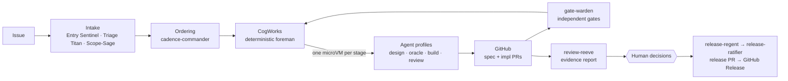

# Overview

**Status:** Proposed architecture, v0.1 (8 November 2026). It describes the target system. See
[roadmap.md](roadmap.md) for what exists today and the order in which the rest will be built.

## What Brightsmiths is

Brightsmiths is a set of small, independent services and a library of agent profiles. Together
they take engineering work from a GitHub issue to a merged pull request and a published GitHub
Release.

The mechanical parts of that journey run without a human babysitting them. Humans spend their
time on decisions they can actually judge:

- what is wanted (intent and acceptance criteria)
- how it should be shaped (architecture and program design)
- exceptions
- releases

The core design rule is: **an LLM is a component inside a deterministic machine, never the
machine itself.** Deterministic services decide what runs, what each agent may see and touch,
and whether its output passes. Agents only produce artifacts.

## Scope

**In scope:** everything from "issue opened" to "GitHub Release published".

**Out of scope:** artifact registries, deployment, device fleets, and anything else downstream of
a GitHub Release. To build on the release, subscribe your own automation to the `release`
webhook through `queue-keeper`.

**Disciplines:** the core (orchestration, gating, isolation, provenance) is discipline-neutral.
Agent profiles and checks are packaged per engineering discipline, so mechanical or electrical
engineering packs can be added by others. Brightsmiths itself ships only the **software** pack.
See [architecture/agent-profiles.md](architecture/agent-profiles.md).

**Hosting:** the system must run on cloud infrastructure and on-prem. No service depends on a
specific cloud provider.

## Guiding principles

| # | Principle | Consequence |
| --- | --- | --- |
| P1 | **GitHub is the system of record** | All work, state, decisions and approvals live in GitHub as issues, labels, comments, pull requests, reviews, check runs and commits. Any service can be restarted without losing data. Telemetry is derived data, never state. |
| P2 | **Deterministic control, probabilistic content** | Routing, gating, context packaging, retries and escalation are code. LLMs only produce artifacts. |
| P3 | **Small services that do a few things well** | Each service has one clear purpose. New responsibilities go into new services or agent profiles, not into existing services that happen to be nearby. |
| P4 | **Boundaries follow trust, not job titles** | Agents are split where an information barrier or a separation of duties is needed. Elsewhere they stay broad, to avoid losing context at hand-offs. |
| P5 | **No self-certification** | Every pass/fail result is recomputed by `gate-warden` from a commit SHA, in a clean sandbox, under its own identity. When an agent claims "tests pass", that claim is ignored. |
| P6 | **The oracle is never writable by its author** | Tests, acceptance checks and holdouts are written by a different identity from the implementation, and are locked before implementation starts. |
| P7 | **Content is data, never instructions** | Untrusted text never reaches a privileged agent raw. Capability limits assume that prompt injection will sometimes succeed. |
| P8 | **Rigor follows risk** | Criticality tiers T0–T3, assigned per module, choose which stages run, their thresholds and the human gates. |
| P9 | **Humans judge decisions, not volume** | Human gates sit at intent, design, exceptions and release, and each comes with a prepared evidence pack. |
| P10 | **Strong isolation** | Every agent run and every gate run executes in its own short-lived microVM, with deny-by-default networking and no secrets inside. |
| P11 | **Chain of custody** | Every service and every stage that acts on work signs an attestation of what it saw and produced. The next stage verifies those attestations before acting. |
| P12 | **Health is continuous and budgeted** | Ratchets run inline on every change. Drift scans run on a schedule. Health work gets a protected share of the issue ordering. |
| P13 | **The harness is a product** | Agent profiles, skills, stage graphs and gate definitions are versioned, evaluated, pinned per repository and rolled out by canary. |

## How the pieces fit

Read next:

- [architecture/system.md](architecture/system.md): layers, components and event flow
- [architecture/services.md](architecture/services.md): the service catalogue
- [architecture/workflow.md](architecture/workflow.md): stages, gates, tiers and human touchpoints
- [adr/](adr/): the decisions behind this design
