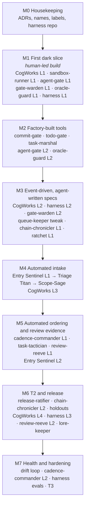

# Roadmap

This page covers how the system gets from today's services to the architecture in this handbook. The factory is bootstrapped: a small set of services is built by hand first, and the factory then builds the rest of Brightsmiths itself. Humans stand in for every service that doesn't exist yet. Each service that is finished retires one stand-in, so the factory gets darker one step at a time.

Track per-service work as issues in that service's repository and link them here.

## Where we are today

| Service | State |
| --- | --- |
| queue-keeper | Code, released (v0.1.0) |
| CogWorks | Code in progress: pipeline executor exists; CLI composition root, GitHub and LLM adapters, and most nodes (#60–#71) still open |
| release-regent | In use |
| glitch-guardian | Early code |
| task-marshal, commit-gate, Entry Sentinel, Triage Titan, Scope-Sage, task-tactician, lore-keeper, webhook-watchman | Specification only |
| agent-gate | Soft-enforcement experiment (hooks and scripts) |
| review-reeve, cadence-commander, todo-gate | No repository |
| gate-warden, sandbox-runner, oracle-guard, ratchet, release-ratifier, chain-chronicler | New in this architecture |

Today's way of working is human-led: a person drives agents (Tester, Coder and the rest) locally, with agent-gate's soft enforcement and CI checks. This is the starting point. It is also how the first services are built.

## Bootstrap rules

1. **Stand-ins first.** Every factory function has an owner at every milestone: a service if it is finished, otherwise a named human stand-in. The [darkness table](#how-dark-the-factory-is-at-each-milestone) shows which.
2. **Trust foundations are never stood in.** Agents run unattended only once sandbox-runner, agent-gate, gate-warden and oracle-guard exist at level 1. Before then, all agent work is human-led.
3. **Build only what retires a stand-in.** A service is built to the level the next milestone needs, not to its full specification. Its later increments are scheduled when a later milestone needs them.
4. **The factory builds its own services from milestone M2.** Services after M1 are built by the factory, with humans doing whatever the missing services would do.
5. **Self-modification guard.** Control-plane and security-boundary repositories are mapped T2 or higher in their `risk-map.yaml`, whoever builds them: CogWorks, sandbox-runner, agent-gate, gate-warden, oracle-guard, the harness, Entry Sentinel, chain-chronicler and release-ratifier. A human reviews every PR to them. gate-warden always reads gate configuration from the default branch, never from the PR it is judging.
6. **Exit with data.** A milestone is finished when its exit criteria are met. If they show humans routinely rewriting agent output, stop and fix that before going darker. A lighter factory with better tooling is still a good outcome.

## Build order

## Milestones

### M0: housekeeping

- [ ] Accept or amend the ADRs in [adr/](adr/).
- [ ] Settle the names of the new services ([open-questions.md](open-questions.md)).
- [ ] Harmonise the label taxonomy across Entry Sentinel, Scope-Sage, task-tactician and CogWorks ([state-model.md](architecture/state-model.md)).
- [ ] Create the harness repository with `disciplines/software/`.
- [ ] Fix documentation drift in service repositories: queue-keeper (NATS support), task-tactician and agent-gate (organisation-specific references).
- [ ] Update the short landing summary in `brightsmiths/.github`.

Repositories for planned services (todo-gate, review-reeve, cadence-commander) are created when the service's milestone starts, not before.

### M1: first dark slice

*Built human-led, in today's way of working.*

**Goal:** CogWorks takes a human-written, human-scoped issue in one T1 repository and runs the unit-oracle and implement stages, each in its own sandbox under its own identity. gate-warden decides pass or fail. A human reviews and merges. The pilot repository is **commit-gate**: small, Rust, specification already written, and needed in M2.

- [ ] CogWorks L1, sandbox-runner L1, agent-gate L1, gate-warden L1, oracle-guard L1, harness L1 (see [service increments](#service-increments)).
- [ ] Infrastructure:
  - [ ] GitHub Apps for the oracle, builder and gate-warden roles
  - [ ] KMS-issued short-lived tokens
  - [ ] model gateway
  - [ ] dependency proxy
  - [ ] one KVM-capable sandbox host

**Exit:**

- A red-team agent cannot write outside its paths, reach the internet, see secrets, or forge a check.
- The first commit-gate slices are merged through the factory.
- Cost per slice is known.

### M2: factory-built tools

*From here on, the factory builds Brightsmiths. Humans still write issues, scope them and start runs from the CLI.*

**Goal:** the factory builds the small CLIs that make its own gates and sandboxes better. Each of them plugs into gate-warden or the sandbox as soon as it is done.

- [ ] commit-gate L1 (finishing the M1 pilot), todo-gate L1, task-marshal L1, agent-gate L2, oracle-guard L2.

**Exit:**

- Zero oracle-integrity bypasses.
- The rate of approvals that change nothing, and the reasons for changes, are tracked per slice.
- Attempts per slice are stable or falling.

### M3: event-driven runs and agent-written specs

**Goal:** a human applies the trigger label instead of running the CLI. Design profiles write the spec (intent, acceptance criteria, contracts, plan) as spec PRs, which humans approve. Stage attestations are signed.

- [ ] CogWorks L2, harness L2, gate-warden L2, queue-keeper actor-trust tweak, chain-chronicler L1, ratchet L1.
- [ ] Optional: webhook-watchman L1 to watch the now event-driven path.

**Exit:**

- Spec PRs approved without changes in a stable share of cases.
- The mutation score on changed code is stable or rising.
- Every run is reconstructable from GitHub state alone.

### M4: automated intake

**Goal:** humans stop screening, triaging and scoping issues by hand. They still decide `state:design` and the factory trigger.

- [ ] Entry Sentinel L1, then Triage Titan L1, then Scope-Sage L1. Each one verifies the attestation of the one before it.
- [ ] CogWorks L3 (verifies those attestations and uses their machine-readable blocks).

**Exit:**

- No unsigned issue reaches CogWorks.
- Quarantine false positives are reviewed and tolerable.
- Scope-Sage's affected areas match the paths actually changed in most runs.

### M5: automated ordering and review evidence

**Goal:** humans stop picking the next issue and stop assembling review context by hand.

- [ ] cadence-commander L1, task-tactician L1, review-reeve L1, Entry Sentinel L2.

**Exit:**

- Time humans spend per review falls, with the evidence report in hand.
- The issue order is accepted without manual reordering in most weeks.

### M6: T2 and release

**Goal:** the first T2 repository runs with the spec/impl/acceptance split and holdouts. Releases are gated and carry provenance.

- [ ] release-ratifier L1, chain-chronicler L2, CogWorks L4, harness L3, gate-warden L3, oracle-guard L3, sandbox-runner L2, review-reeve L2, lore-keeper L1.
- [ ] Private holdouts repository.

**Exit:**

- The visible-vs-holdout gap is small and stable.
- Escaped defects are no worse than the human baseline.
- An auditor-style walkthrough from requirement to release succeeds.

### M7: health and hardening

**Goal:** long-term code health runs as a budgeted loop. The harness is released like a product.

- [ ] Harness L4 (drift-scan and debt-fix profiles, golden tasks, cheat traps, pinning and canary rollout).
- [ ] cadence-commander L2 (health share).
- [ ] CogWorks scheduled runs.
- [ ] T3 profile.
- [ ] Documented discipline-pack interface.
- [ ] C# and TypeScript toolchains.

**Exit:**

- Every cheat trap is disputed and none passes.
- No harness release regresses the scorecard.
- Files changed per change stays flat.

## How dark the factory is at each milestone

**H** = a human does it (the stand-in). Named cells are a service or an agent stage.

| Function | M1 | M2 | M3 | M4 | M5 | M6 | M7 |
| --- | --- | --- | --- | --- | --- | --- | --- |
| Issue safety check | H (org-member issues only) | H | H | Entry Sentinel | Entry Sentinel (+ quarantined LLM pass) | ← | ← |
| Triage (priority, type, missing info) | H | H | H | Triage Titan | ← | ← | ← |
| Scoping assessment | H | H | H | Scope-Sage | ← | ← | ← |
| Choosing the next issue | H | H | H | H | cadence-commander | ← | + health share |
| Starting a run | H (CLI) | H (CLI) | H (trigger label) | H (label) | H (label) | H (label) | H (label) + schedule |
| Intent, criteria, contracts, plan | H writes | H writes | Agents write, H approves | ← | ← | + architect, H approves (T2) | ← |
| Oracle authoring | Agent (zone B) | ← | ← | ← | ← | + acceptance and holdouts | ← |
| Implementation | Agent (zone C) | ← | ← | ← | ← | + refactor | + debt-fix |
| Gating | gate-warden (scope, oracle lock and inventory, build, lint, tests) | + commit-gate, todo-gate, red-check, sniff | + spec gates, ratchet, human-transition checks | ← | ← | + tiers, holdouts, mutation thresholds, G8/G9 | ← |
| Review evidence | H reads gate results | H | H | H | review-reeve | + reviewer agents, designated reviewer | ← |
| Merge | H | H | H | H | H | H | H |
| Release PR | release-regent | ← | ← | ← | ← | ← | ← |
| Release gate and approval | H | H | H | H | H | release-ratifier + H (T2+) | ← |
| Provenance | CogWorks audit comments | ← | chain-chronicler signing | ← | ← | + attestation store, SBOM, telemetry | ← |
| Health scans | — | — | — | — | — | — | drift-scan profile |

Merging stays human throughout this roadmap. Whether T0/T1 merges can be automated is an [open question](open-questions.md).

## Service increments

Each service is built only to the level a milestone needs. **Done** is the milestone at which the service is complete *for its role in the factory*. Work beyond that follows the service's own roadmap in its repository.

**Built** says who builds each increment:

- **Human-led:** today's way of working.
- **Factory:** CogWorks, with humans standing in for missing services.
- **Factory + review:** factory-built, with every PR human-reviewed under bootstrap rule 5.

### Built by hand for M1

**CogWorks** (done at M6; scheduled runs added in M7)

| Level | Built | Needed by | Scope |
| --- | --- | --- | --- |
| L1 | Human-led | M1 | CLI composition root and `run` command (#70, #71). GitHub issue, PR and repository adapters (#63, #64). LLM adapter routed through the model gateway (#65). Stage types `unit-oracle` and `implement`, with the rework loop. Profile selection and context bundles from the harness. Runtime provider delegating to sandbox-runner. Verdicts read from gate-warden check runs. The open node work (#60–#62) is reshaped into stage types. |
| L2 | Factory + review | M3 | Webhook/queue event source (#67) on the trigger label. Stage types `specify`, `contract`, `plan` producing spec PRs and sub-issues. Tier derived from `risk-map.yaml`. |
| L3 | Factory + review | M4 | Verify Entry Sentinel, Triage Titan and Scope-Sage attestations. Use the triage and affected-areas blocks. Remove the Intake node's own injection scan. |
| L4 | Factory + review | M6 | Stage types `architect`, `acceptance-oracle`, `refactor`, `review-semantic`, `review-security`. Holdout runs. Repository split for T2. |

**sandbox-runner** (done at M6)

| Level | Built | Needed by | Scope |
| --- | --- | --- | --- |
| L1 | Human-led | M1 | microsandbox provider. Applies agent-gate mount plans. Read-only root filesystem, no secrets, egress allowlist (model gateway, dependency proxy), resource limits. Runner-side push with role tokens. Also hosts gate-warden's check runs. |
| L2 | Factory + review | M6 | A second provider (Firecracker or Kata). Pre-warmed images and read-only dependency caches. |

**agent-gate** (done at M2)

| Level | Built | Needed by | Scope |
| --- | --- | --- | --- |
| L1 | Human-led | M1 | Roles read from the harness (oracle, builder). Mount-plan output. Commit-range scope-check CLI. |
| L2 | Factory + review | M2 | File-ownership and sticky-directory plans for colocated locked files. Quality checks handed to commit-gate, so agent-gate is about boundaries only. |

**gate-warden** (done at M6)

| Level | Built | Needed by | Scope |
| --- | --- | --- | --- |
| L1 | Human-led | M1 | Its own App. Runs on PR pushes, from the SHA, in a sandbox, with gate configuration from the default branch. Checks: agent-gate scope, oracle-guard L1, build, format, lint, tests. The only required-check source. |
| L2 | Factory + review | M3 | Spec-PR gates (G1, G3, G4). Verifies human-only labels and approvals. Runs commit-gate, todo-gate and ratchet. |
| L3 | Factory + review | M6 | Tier thresholds, holdouts, mutation, G8 findings and G9 inputs. |

**oracle-guard** (done at M6)

| Level | Built | Needed by | Scope |
| --- | --- | --- | --- |
| L1 | Human-led | M1 | `lock` (signed manifest), `inventory` (cargo-nextest JUnit). |
| L2 | Factory + review | M2 | `config-guard`, `red-check`, `sniff`. |
| L3 | Factory + review | M6 | `holdout-inject`. |

**Harness (repository)** (done at M7)

| Level | Built | Needed by | Scope |
| --- | --- | --- | --- |
| L1 | Human-led | M1 | Software pack with `unit-oracle` and `implement` profiles, ported from the existing Tester and Coder agent definitions. Stage-contract schema. G6-lite gate configuration. |
| L2 | Factory + review | M3 | `specify`, `contract`, `plan` profiles. |
| L3 | Factory + review | M6 | `architect`, `acceptance-oracle`, `refactor` and reviewer profiles. T2 gate configuration. |
| L4 | Factory + review | M7 | `drift-scan`, `debt-fix`, golden tasks, cheat traps, pinning and canary rollout. |

### Built by the factory

**commit-gate** (done at M2)

| Level | Built | Needed by | Scope |
| --- | --- | --- | --- |
| L1 | Factory (M1 pilot) | M2 | Check pipeline, git-wrapper mode, CI mode. |

**todo-gate** (done at M2; new repository)

| Level | Built | Needed by | Scope |
| --- | --- | --- | --- |
| L1 | Factory | M2 | Marker scan, two-level-fingerprint allowlist, stale-entry detection, CI mode, protected allowlist. |

**task-marshal** (done for the factory role at M2; its other sources follow its own roadmap)

| Level | Built | Needed by | Scope |
| --- | --- | --- | --- |
| L1 | Factory | M2 | CogWorks bundle source (`next`, `done`), `dispute`. |

**queue-keeper** (done at M3)

| Level | Built | Needed by | Scope |
| --- | --- | --- | --- |
| tweak | Factory | M3 | Actor-trust field on normalised events. NATS documentation. |

**chain-chronicler** (done at M6)

| Level | Built | Needed by | Scope |
| --- | --- | --- | --- |
| L1 | Factory + review | M3 | Signing library: in-toto/DSSE, Ed25519 via the KMS. Used by CogWorks and gate-warden. |
| L2 | Factory + review | M6 | Attestation store, OTel pipeline, factory scorecard. |

**ratchet** (done at M3)

| Level | Built | Needed by | Scope |
| --- | --- | --- | --- |
| L1 | Factory | M3 | Baselines (complexity, duplication, warnings, suppressions), mutation on changed code. |

**webhook-watchman** (optional at M3)

| Level | Built | Needed by | Scope |
| --- | --- | --- | --- |
| L1 | Factory | M3 | Delivery metrics as specified. |

**Entry Sentinel** (done at M5)

| Level | Built | Needed by | Scope |
| --- | --- | --- | --- |
| L1 | Factory + review | M4 | Deterministic scan, signed approval via chain-chronicler, quarantine, re-scan on edit, ignores external actors. |
| L2 | Factory + review | M5 | Quarantined LLM second pass. |

**Triage Titan** (done at M4)

| Level | Built | Needed by | Scope |
| --- | --- | --- | --- |
| L1 | Factory | M4 | Verifies Entry Sentinel's attestation. Priority and type labels, information requests, signed triage block. |

**Scope-Sage** (done at M4)

| Level | Built | Needed by | Scope |
| --- | --- | --- | --- |
| L1 | Factory | M4 | Assessment on `state:design`, signed, with the affected-areas block. |

**cadence-commander** (done at M7; new repository)

| Level | Built | Needed by | Scope |
| --- | --- | --- | --- |
| L1 | Factory | M5 | WSJF issue ordering across repositories, published as GitHub state that CogWorks reads. |
| L2 | Factory | M7 | Reserved health share. |

**task-tactician** (done at M5)

| Level | Built | Needed by | Scope |
| --- | --- | --- | --- |
| L1 | Factory | M5 | Workflow labels and dependency tracking with the factory label namespaces. Leaves CogWorks branches alone. |

**review-reeve** (done at M6; new repository)

| Level | Built | Needed by | Scope |
| --- | --- | --- | --- |
| L1 | Factory | M5 | Evidence report from gate results and the requirement trace. CODEOWNERS reviewer assignment. |
| L2 | Factory | M6 | Reviewer-agent findings. Designated (H3) reviewer assignment. |

**release-ratifier** (done at M6)

| Level | Built | Needed by | Scope |
| --- | --- | --- | --- |
| L1 | Factory + review | M6 | Required check on release PRs (attestation chain, SBOM, approvals for the tier). Attaches evidence to the GitHub Release. |

**lore-keeper** (done at M6)

| Level | Built | Needed by | Scope |
| --- | --- | --- | --- |
| L1 | Factory | M6 | Semantic search MCP over ADR corpora, including this handbook. Offered to design profiles. |

### Unchanged

**release-regent:** already in use; no changes. **glitch-guardian:** no factory role yet ([open questions](open-questions.md)).
